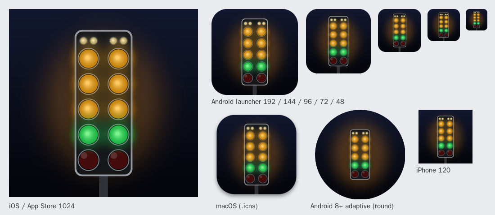

# Drag Tree app icons

A two-lane drag tree at night: stage bulbs, three ambers and the green lit,
reds off. Everything here is drawn by `make_icons.py` (Python + Pillow), so to
change a colour or the layout, edit the script and run `python make_icons.py`.

## Folders

| Folder | What it is |
|---|---|
| `Android/` | Launcher icons 36, 48, 72, 96, 144, 192 (rounded square) |
| `Android/Adaptive/` | Optional Android 8+ adaptive icon (layers + XML), see below |
| `iOS/` | Every iPhone/iPad size Delphi 12 lists, plus the 1024 App Store icon. Square with no transparency, because iOS rounds the corners itself |
| `macOS/` | `DragTree.icns` (Big Sur style rounded tile) and a 1024 PNG |
| `Windows/` | `DragTree.ico` (16 to 256) |
| `Store/` | `PlayStore_512x512.png` for the Google Play listing, `AppStore_1024x1024.png` for App Store Connect |

## Setting them in Delphi

Open **Project > Options > Application > Icons**. At the top choose the
target, for example **All configurations - Android 64-bit platform**, so
Debug and Release both get the icons. Click the **...** next to each entry
and pick the matching file. Paths are relative to the project folder, so the
`Icons\...` paths stay valid on any machine.

### Android (already set in DragTree.dproj)

The project already points **Android 32-bit** and **Android 64-bit** at these
launcher icons, so there is nothing to pick by hand:

| Option | File |
|---|---|
| Launcher icon (36x36) | `Icons\Android\LauncherIcon_36x36.png` |
| Launcher icon (48x48) | `Icons\Android\LauncherIcon_48x48.png` |
| Launcher icon (72x72) | `Icons\Android\LauncherIcon_72x72.png` |
| Launcher icon (96x96) | `Icons\Android\LauncherIcon_96x96.png` |
| Launcher icon (144x144) | `Icons\Android\LauncherIcon_144x144.png` |
| Launcher icon (192x192) | `Icons\Android\LauncherIcon_192x192.png` |

Leave **Use adaptive icon** unticked on the Icons page: the adaptive icon is
deployed as plain files instead (see below), which the IDE never rewrites.
The splash background colour is `#121212`, the app's own background, so
Android 12+ shows the tree icon on dark grey at launch instead of white.
The legacy splash image stays off, like the iPhone launch screen.

If the **Project > Deployment** `ic_launcher.png` rows ever go back to
`FM_LauncherIcon_...`, click **Revert to default** there.

### iOS (iOS Device 64-bit)

| Option | File |
|---|---|
| Application icon / App Store (1024x1024) | `Icons\iOS\iOS_AppStore_1024x1024.png` |
| iPhone application icon (120x120) | `Icons\iOS\iPhone_AppIcon_120x120.png` |
| iPhone application icon (180x180) | `Icons\iOS\iPhone_AppIcon_180x180.png` |
| iPhone spotlight (80x80) | `Icons\iOS\iPhone_Spotlight_80x80.png` |
| iPhone spotlight (120x120) | `Icons\iOS\iPhone_Spotlight_120x120.png` |
| iPhone settings (58x58) | `Icons\iOS\iPhone_Setting_58x58.png` |
| iPhone settings (87x87) | `Icons\iOS\iPhone_Setting_87x87.png` |
| iPhone notification (40x40) | `Icons\iOS\iPhone_Notification_40x40.png` |
| iPhone notification (60x60) | `Icons\iOS\iPhone_Notification_60x60.png` |
| iPad application icon (152x152) | `Icons\iOS\iPad_AppIcon_152x152.png` |
| iPad application icon (167x167) | `Icons\iOS\iPad_AppIcon_167x167.png` |
| iPad spotlight (80x80) | `Icons\iOS\iPad_Spotlight_80x80.png` |
| iPad settings (58x58) | `Icons\iOS\iPad_Setting_58x58.png` |
| iPad notification (40x40) | `Icons\iOS\iPad_Notification_40x40.png` |

Each file name says its pixel size, so match on the size in brackets if the
IDE labels differ slightly. Repeat for **iOS Simulator ARM 64-bit** if you use it.

### macOS (macOS 64-bit and macOS ARM 64-bit)

Set **Application icon (.icns)** to `Icons\macOS\DragTree.icns`.

### Windows (32-bit and 64-bit)

Set **Application icon (.ico)** to `Icons\Windows\DragTree.ico`.

## Android 8+ adaptive icon (already deployed)

On Android 8 and later, launchers shape an adaptive icon themselves instead of
putting an old-style icon inside a white circle. `DragTree.dproj` deploys
these as plain files (Debug and Release, Android and Android 64-bit), so they
show in **Project > Deployment** as ordinary rows:

| Local file | Remote Path | Remote Name |
|---|---|---|
| `Icons\Android\Adaptive\ic_launcher.xml` | `res\drawable-anydpi-v26\` | `ic_launcher.xml` |
| `Icons\Android\Adaptive\v33\ic_launcher.xml` | `res\drawable-anydpi-v33\` | `ic_launcher.xml` |
| `Icons\Android\Adaptive\ic_launcher_foreground.png` | `res\drawable-xxxhdpi\` | `ic_launcher_foreground.png` |
| `Icons\Android\Adaptive\ic_launcher_background.png` | `res\drawable-xxxhdpi\` | `ic_launcher_background.png` |
| `Icons\Android\Adaptive\ic_launcher_monochrome.png` | `res\drawable-xxxhdpi\` | `ic_launcher_monochrome.png` |

The v33 file adds the monochrome layer used by Android 13 themed icons.
Uninstall the app from the phone before testing, because launchers cache icons.

## Store listings

- **Google Play**: upload `Store\PlayStore_512x512.png` as the app icon in
  Play Console (Grow > Store presence > Main store listing).
- **Apple App Store**: Delphi puts the 1024 icon into the app bundle, and App
  Store Connect takes it from there. `Store\AppStore_1024x1024.png` is the same
  image if you need it separately.
