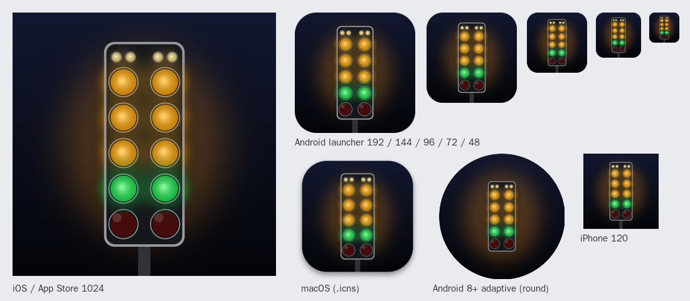

# Drag Tree app icons

A two-lane drag tree at night: stage bulbs, three ambers and the green lit,
reds off. Everything here is drawn by `make_icons.py` (Python + Pillow), so to
change a colour or the layout, edit the script and run `python make_icons.py`.

## Folders

| Folder | What it is |
|---|---|
| `Android/` | Launcher icons 36, 48, 72, 96, 144, 192 (rounded square) |
| `Android/Adaptive/` | Optional Android 8+ adaptive icon (layers + XML), see below |
| `iOS/` | Every iPhone/iPad size Delphi 12 lists, plus the 1024 App Store icon. Square with no transparency, because iOS rounds the corners itself |
| `macOS/` | `DragTree.icns` (Big Sur style rounded tile) and a 1024 PNG |
| `Windows/` | `DragTree.ico` (16 to 256) |
| `Store/` | `PlayStore_512x512.png` for the Google Play listing, `AppStore_1024x1024.png` for App Store Connect |

## Setting them in Delphi 12

Open **Project > Options > Application > Icons**. At the top choose the
target, for example **All configurations - Android 64-bit platform**, so
Debug and Release both get the icons. Click the **...** next to each entry
and pick the matching file. Paths are relative to the project folder, so the
`Icons\...` paths stay valid on any machine.

### Android (do Android 32-bit too if you build it)

| Option | File |
|---|---|
| Launcher icon (36x36) | `Icons\Android\LauncherIcon_36x36.png` |
| Launcher icon (48x48) | `Icons\Android\LauncherIcon_48x48.png` |
| Launcher icon (72x72) | `Icons\Android\LauncherIcon_72x72.png` |
| Launcher icon (96x96) | `Icons\Android\LauncherIcon_96x96.png` |
| Launcher icon (144x144) | `Icons\Android\LauncherIcon_144x144.png` |
| Launcher icon (192x192) | `Icons\Android\LauncherIcon_192x192.png` |

The notification icons and splash images can stay as they are; the app
doesn't send notifications and the splash is turned off.

After changing them, open **Project > Deployment**, pick the Android 64-bit
platform and Release/Debug, and check the `ic_launcher.png` rows now point at
`Icons\Android\...`. If they still show `FM_LauncherIcon_...`, click
**Revert to default** (the same fix as the first-run crash).

### iOS (iOS Device 64-bit)

| Option | File |
|---|---|
| Application icon / App Store (1024x1024) | `Icons\iOS\iOS_AppStore_1024x1024.png` |
| iPhone application icon (120x120) | `Icons\iOS\iPhone_AppIcon_120x120.png` |
| iPhone application icon (180x180) | `Icons\iOS\iPhone_AppIcon_180x180.png` |
| iPhone spotlight (80x80) | `Icons\iOS\iPhone_Spotlight_80x80.png` |
| iPhone spotlight (120x120) | `Icons\iOS\iPhone_Spotlight_120x120.png` |
| iPhone settings (58x58) | `Icons\iOS\iPhone_Setting_58x58.png` |
| iPhone settings (87x87) | `Icons\iOS\iPhone_Setting_87x87.png` |
| iPhone notification (40x40) | `Icons\iOS\iPhone_Notification_40x40.png` |
| iPhone notification (60x60) | `Icons\iOS\iPhone_Notification_60x60.png` |
| iPad application icon (152x152) | `Icons\iOS\iPad_AppIcon_152x152.png` |
| iPad application icon (167x167) | `Icons\iOS\iPad_AppIcon_167x167.png` |
| iPad spotlight (80x80) | `Icons\iOS\iPad_Spotlight_80x80.png` |
| iPad settings (58x58) | `Icons\iOS\iPad_Setting_58x58.png` |
| iPad notification (40x40) | `Icons\iOS\iPad_Notification_40x40.png` |

Each file name says its pixel size, so match on the size in brackets if the
IDE labels differ slightly. Repeat for **iOS Simulator ARM 64-bit** if you use it.

### macOS (macOS 64-bit and macOS ARM 64-bit)

Set **Application icon (.icns)** to `Icons\macOS\DragTree.icns`.

### Windows (32-bit and 64-bit)

Set **Application icon (.ico)** to `Icons\Windows\DragTree.ico`.

## Optional: Android 8+ adaptive icon

On Android 8 and later some launchers (Pixel, Samsung) put old-style icons
inside a white circle or square. An adaptive icon avoids that and lets the
launcher shape it. The project doesn't deploy an adaptive icon today, so the
launcher PNGs above are what Android uses; this step is only polish.

If your Icons page has an **Adaptive icon** section, point it at the files
below. If not, add them in **Project > Deployment** (Android 64-bit, All
configurations) with **Add files**, then set each row's Remote Path and
Remote Name:

| Local file | Remote Path | Remote Name |
|---|---|---|
| `Icons\Android\Adaptive\ic_launcher.xml` | `res\drawable-anydpi-v26\` | `ic_launcher.xml` |
| `Icons\Android\Adaptive\v33\ic_launcher.xml` | `res\drawable-anydpi-v33\` | `ic_launcher.xml` |
| `Icons\Android\Adaptive\ic_launcher_foreground.png` | `res\drawable\` | `ic_launcher_foreground.png` |
| `Icons\Android\Adaptive\ic_launcher_background.png` | `res\drawable\` | `ic_launcher_background.png` |
| `Icons\Android\Adaptive\ic_launcher_monochrome.png` | `res\drawable\` | `ic_launcher_monochrome.png` |

The v33 file adds the monochrome layer used by Android 13 themed icons.
Uninstall the app from the phone before testing, because launchers cache icons.

## Store listings

- **Google Play**: upload `Store\PlayStore_512x512.png` as the app icon in
  Play Console (Grow > Store presence > Main store listing).
- **Apple App Store**: Delphi puts the 1024 icon into the app bundle, and App
  Store Connect takes it from there. `Store\AppStore_1024x1024.png` is the same
  image if you need it separately.
